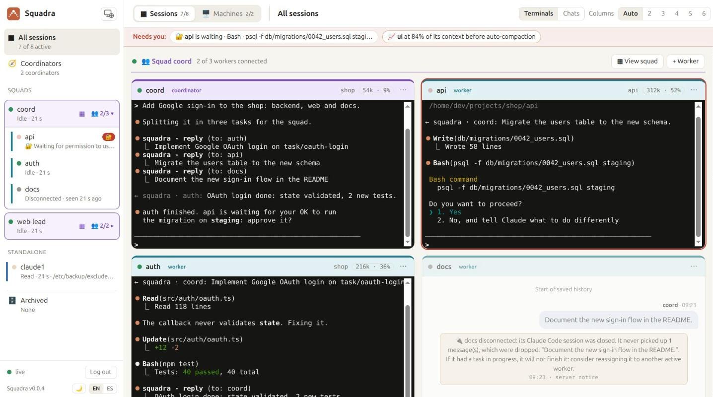
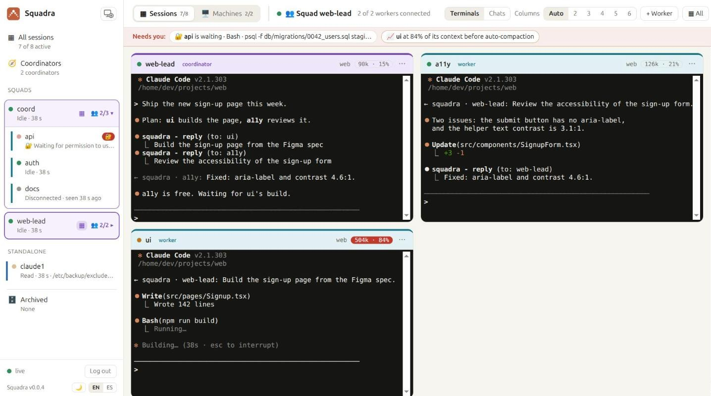

<p align="center"></p>

<h1 align="center">Squadra: multi-agent Claude Code with a coordinator and a live dashboard</h1>

<p align="center"><b>A coordinator agent that runs squads of Claude Code agents — fast, unattended, and visible live.</b></p>

<p align="center">
  <a href="https://github.com/roke22/Squadra/releases"></a>
  <a href="https://github.com/roke22/Squadra/actions/workflows/test.yml"></a>
  <a href="LICENSE"></a>
  
  
  <a href="https://github.com/roke22/Squadra/stargazers"></a>
</p>

<p align="center"><a href="README-es.md">Leer en español</a> · <a href="https://roke22.github.io/Squadra/">Website</a> · <a href="docs/reference.md">Reference</a> · <a href="https://github.com/roke22/Squadra/discussions">Discussions</a> · v0.0.5</p>

---

Squadra gives [Claude Code](https://claude.com/product/claude-code) a **coordinator**: you tell it what you want, and it splits the work among a squad of **workers** (other Claude Code sessions), follows their progress, approves their safe actions and only comes back to you for the decisions that matter.

A web dashboard shows the whole squad live, like a wall of terminals: what each agent is doing, what Claude is saying, and who is waiting for you. From there you also add your computers and open new sessions on them.

Squadra is **multi-agent orchestration for Claude Code**: parallel Claude Code sessions on one machine or many, coordinated by another Claude Code session, with a self-hosted web dashboard and web terminal to run and watch them from any browser. It is open source (MIT), a single Node.js server with no dependencies, and installs as a Claude Code plugin.

## Quick start

```bash
git clone https://github.com/roke22/Squadra.git squadra && cd squadra
node server/server.js          # dashboard at http://127.0.0.1:7787
```

Sign in with the server token it prints, open **Machines → + Add machine** and run the one command it shows on each computer where agents should work. That's it: the details, Docker and HTTPS are in [steps 1 and 2](#1-install-the-dashboard) below.

### Just want to try it? Docker

One command starts the dashboard *and* a machine that runs Claude Code, in a single container. Everything it keeps (the dashboard's data, Claude Code's login, your projects) goes in one folder, `deploy/demo/squadra`.

**1. Start it** (the first time it builds the image, a few minutes):

```bash
cd deploy/demo
docker-compose up -d        # or: docker compose up -d
```

**2. Read the sign-in token**, once it has started (some 20 seconds):

```bash
cat squadra/data/server-token
```

It is also in the logs, in the *Squadra demo* box: `docker-compose logs`. It stays the same when the container restarts.

**3. Sign in:** open **http://localhost:7787** and paste the token. Then **+ New session** (or 🏢 **Org chart → + Squad**) with the folder `/squadra/projects/demo`, an example project with three personas. The first time, Claude Code asks in the session's terminal for its theme, your Claude login (`/login`) and whether you trust the folder; the login is kept for every later session.

To stop it, `docker-compose down` (the folder stays). After a `git pull`, `docker-compose up -d --build` builds it again. Only this computer can reach it. More in [the demo's README](deploy/demo/README.md).



## What you can do with it

- **Build a feature across several repositories at once:** the backend, the web app and the mobile app, each with its own worker, kept in step by the coordinator.
- **Split a big job into parallel pieces:** a migration, a refactor or more tests, one worker per module.
- **Leave it working unattended:** workers decide the technical details and the coordinator approves their safe actions, so the squad keeps going while you are away.
- **Keep watch from anywhere:** every agent live in your browser, and a "Needs you" bar for whoever is waiting for an answer.
- **Use all your computers and accounts:** each agent runs on any machine you add, with that machine's Claude Code login.
- **Build teams with your own skills:** give each agent a skill or agent from its project (design, marketing, HR, code review…) as its persona, and save the whole squad as a template to open it again in one click.
- **Link squads:** link the coordinators of two squads (design and marketing, say) so they share work, each handing what it takes on to its own workers.
- **See and shape your whole organisation:** the org chart shows every squad, its agents and how squads are linked, with what each one is for on hover; add, describe, link, move and close them from there.

## How it works

```
                    you
                     │  talk in its terminal
             ┌───────┴────────┐
             │  coordinator   │  plans, delegates, approves, reports
             └───────┬────────┘
                     │  messages through squadra-server
      ┌──────────────┼──────────────┬──────────────┐
 ┌────┴─────┐   ┌────┴─────┐   ┌────┴─────┐   ┌────┴─────┐
 │ worker 1 │   │ worker 2 │   │ worker 3 │   │ worker N │   each one a Claude Code
 └──────────┘   └──────────┘   └──────────┘   └──────────┘   session, on any machine
```

- **The coordinator** is a Claude Code session with the coordinator role. It turns your request into tasks, assigns them to workers, answers their questions, approves harmless actions and escalates only what is critical.
- **Workers** are Claude Code sessions with the worker role, each in its own project folder. They decide technical details themselves, and every task ends with a final report (done, blocked, failed or a question): Claude Code doesn't let them finish without it.
- **`squadra-server`** relays messages between agents and serves the dashboard. Agents connect *out* to it, so their machines open no ports.
- **The `squadra` plugin** delivers each message into the agent's session, even while it is idle, through Claude Code [Channels](https://code.claude.com/docs/en/channels), and reports what the agent is doing to the dashboard.

Every agent is a normal interactive `claude` in a terminal, so you can step in and type into any of them at any time.

## Squadra vs Claude Code Agent Teams and subagents

Claude Code already has [subagents](https://code.claude.com/docs/en/sub-agents) and experimental Agent Teams. Squadra is for when those stop being enough:

| | Subagents | Agent Teams | Squadra |
|---|---|---|---|
| Agents run on | the same session | the same machine | any machine you add, each with its own Claude Code login |
| Watch them | in one terminal | one terminal each | one live web dashboard with every agent, from any browser |
| Unattended work | you approve each prompt | you approve each prompt | the coordinator approves safe actions, you only get the critical ones |
| Open and reopen sessions | manually | manually | from the dashboard, with a web terminal into each agent |
| Several repositories at once | no | the lead's directory | one worker per repository, on the machine that has it |

Squadra adds to Claude Code rather than replacing it: subagents and Agent Teams still work inside each session.

## What you need

- **A Claude Code account** with a claude.ai plan (Pro, Max, Team or Enterprise) or an Anthropic Console API key. On Team and Enterprise, an Owner enables *Channels* in the organization settings.
- **A computer for the dashboard,** with [Node.js 22](https://nodejs.org) or Docker. It can be the same computer where your agents run.

The computers where the agents run get everything else installed for them when you add them (see step 2).

## 1. Install the dashboard

```bash
git clone https://github.com/roke22/Squadra.git squadra && cd squadra
node server/server.js
```

Open **http://127.0.0.1:7787** and sign in with the **server token** it prints when it starts (it is also saved in `data/server-token`).

**With Docker** instead:

```bash
docker build -f server/Dockerfile -t squadra-server .
docker run -d --name squadra-server -p 127.0.0.1:7787:7787 -e PUBLIC_URL=http://127.0.0.1:7787 -v squadra-data:/data squadra-server
docker logs squadra-server      # shows the server token
```

**To use it from other computers,** give it a domain: point the domain to this computer, open ports 80 and 443, and start it with

```bash
node server/server.js --domain squadra.example.com --acme-email you@example.com
```

It gets and renews its HTTPS certificate by itself, and the dashboard is at `https://squadra.example.com`. (On Linux, ports 80 and 443 need privileges: run it with `sudo`, or use the Docker image with `-p 80:80 -p 443:443 -e SQUADRA_DOMAIN=squadra.example.com`.)

## 2. Add your computers

In the dashboard, open **🖥️ Machines → + Add machine**, choose the computer's system (Linux, macOS or Windows) and **follow the instructions it shows**: it's a single command to run on that computer. It installs everything it needs and connects it to your dashboard.

Then, still in the dashboard:

1. **+ Folder** on the machine's card: choose the folders where agents may work (your projects).
2. **+ New session**: open a **coordinator**, then its **workers**. Each one opens in a live terminal in your browser. The first time, accept Claude Code's prompts (for the development channel, choose *"I am using this for local development"*).
3. **Talk to the coordinator** in its terminal and tell it what you want done.



## Good tips

- **Use HTTPS** (a domain, step 1) when other computers connect to your dashboard, and keep the server token to yourself: it's the key to the dashboard.
- **Give your coordinator its own repository** with a `CLAUDE.md` describing your team: which worker handles which repository, what counts as done, and what it must always ask you first. Every coordinator you open from it then works the same way.
- **Name workers after what they do** (`api`, `web`, `docs`): the coordinator uses the names to decide who gets each task.
- **Give each worker a persona:** in **+ New session**, pick one of the skills (`.claude/skills/<name>/SKILL.md`) or agents (`.claude/agents/<name>.md`) the machine finds in that folder or in `~/.claude`. It goes into the agent's system prompt, so it holds through compactions, and its coordinator is told which persona each worker follows.
- **One worker per repository or area,** so they don't edit the same files. For parallel work in one repository, give each worker its own [git worktree](https://git-scm.com/docs/git-worktree).
- **Open your own projects,** or repositories you trust, in the agents' folders.
- **Leave room in the context:** with 1M-context models, the dashboard's default of auto-compacting at 600K tokens keeps agents sharp.

## Updating

Update the dashboard (`git pull` and start it again, or rebuild the Docker image), then run `squadra-host update` on each computer. The dashboard tells you which ones are out of date.

## FAQ

**What does the coordinator approve on its own, and what does it ask me?**
It approves what has no side effects: reading files, searching, running tests and local builds. Anything destructive, irreversible or with effects outside the machine (deleting data, force pushes, deploying, publishing, spending money, credentials) it asks you first, as do product decisions and anything about security or costs. Workers decide technical details themselves. The rules live in the plugin's instructions and in your coordinator's `CLAUDE.md`, so you can tighten them.

**Does it work with my Claude plan?**
Yes, with any claude.ai plan that includes Claude Code (Pro, Max, Team, Enterprise) or with an Anthropic Console API key. Each agent is a normal Claude Code session on its machine, with that machine's login, so it counts against that account like any other session.

**What does the "add machine" command install?**
What is missing among tmux, Node.js 22 and Claude Code, then `squadra-host`: a small Node program that connects the machine to your server, installs the `squadra` plugin and stays running as a user service. The script is [install/linux.sh](install/linux.sh) (and [macos.sh](install/macos.sh), [windows.bat](install/windows.bat)); it is read in full before anything runs.

**What leaves my machines?**
Only what goes to **your** Squadra server: messages between agents, presence, and what you choose to show in the dashboard (`--observe off|activity|full`). Recognisable secrets are masked, and files from credentials folders are never sent. Nothing goes to any other service. Details in the [plugin README](plugins/squadra/README.md).

**Do I need to open ports on the machines where agents run?**
No. Agents connect out to the server. Only the server needs to be reachable, and with a domain it gets its own HTTPS certificate.

**Is it a replacement for Agent Teams or subagents?**
No, it works alongside them: those run inside one session on one machine; Squadra coordinates whole sessions across machines and lets the squad keep going without you watching.

**Why the "development channel" flag?**
Channels are the Claude Code feature that delivers messages into a session. Until the plugin is in Anthropic's directory, Claude Code asks you to confirm loading a channel plugin the first time. Choose *"I am using this for local development"*.

## Learn more

- [docs/reference.md](docs/reference.md): setting agents up by hand without the dashboard, every server option, and how it all works.
- [PLAN.md](PLAN.md): the full technical guide (Spanish).

## Contributing

Bugs and ideas go to [Issues](https://github.com/roke22/Squadra/issues); questions and show-and-tell to [Discussions](https://github.com/roke22/Squadra/discussions). See [CONTRIBUTING.md](CONTRIBUTING.md) for how to run the tests and send a pull request. If Squadra is useful to you, a ⭐ on GitHub helps other people find it.

## License

[MIT](LICENSE) — free to use, copy, modify and distribute, for any purpose.
