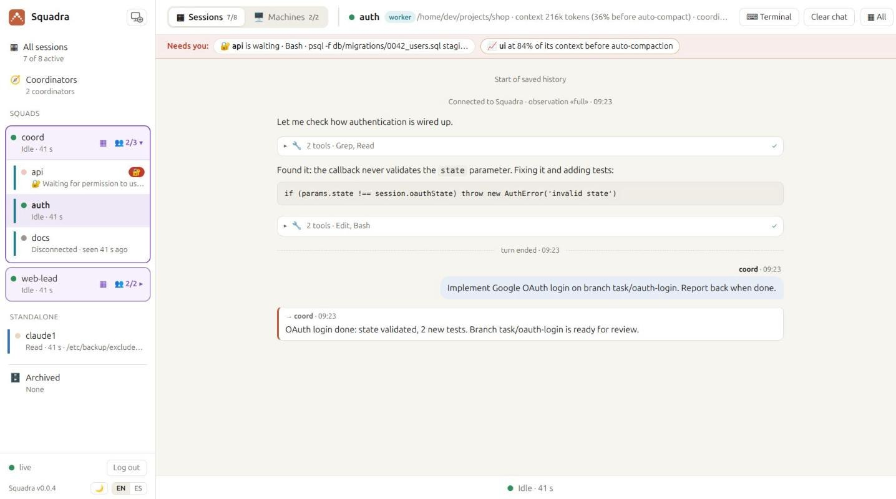
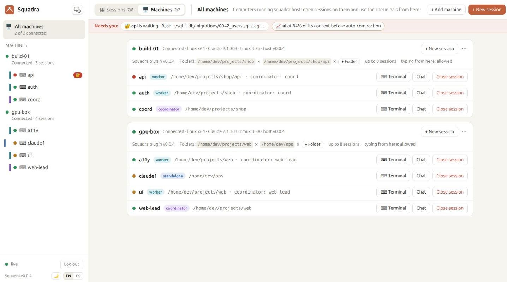
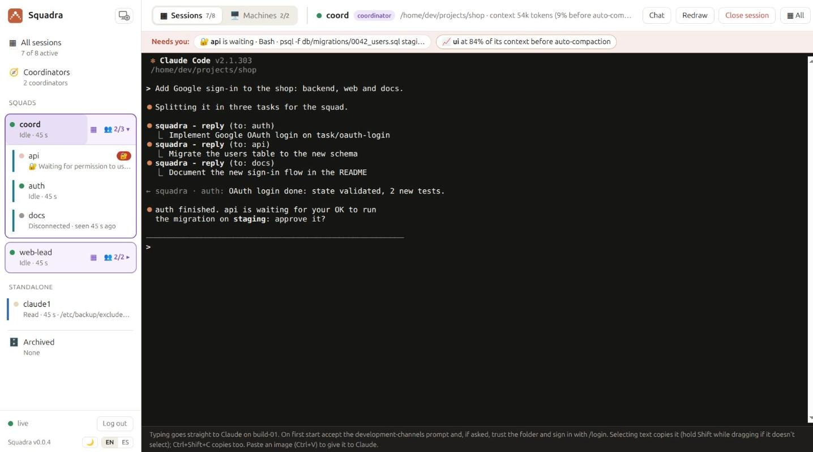
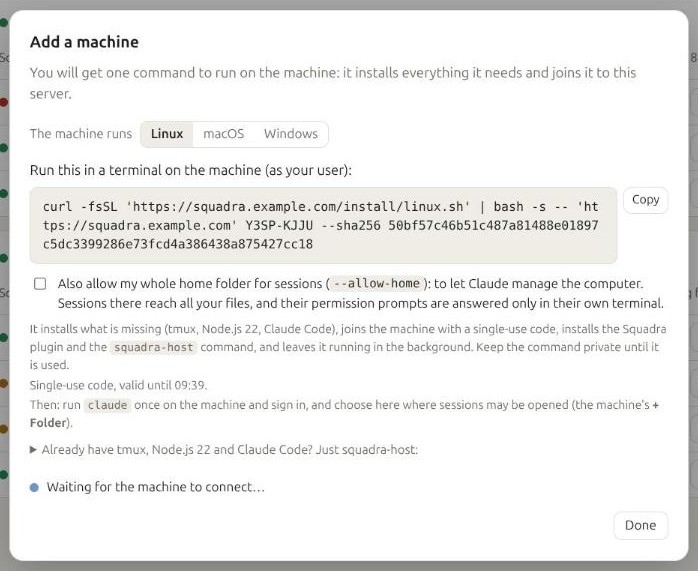
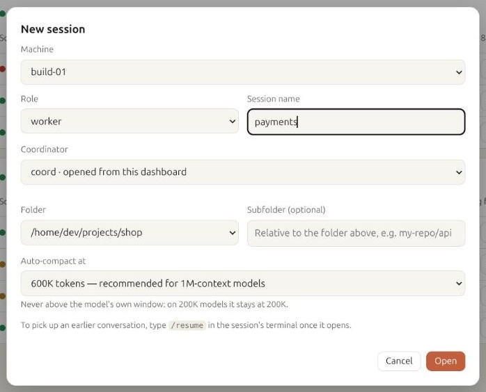
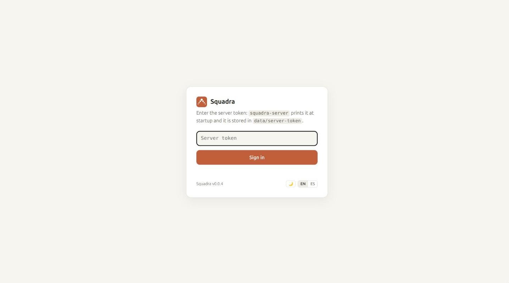

<p align="center"></p>

<h1 align="center">Squadra</h1>

<p align="center"><b>A coordinator agent that runs squads of Claude Code agents — fast, unattended, and visible live.</b></p>

<p align="center"><a href="referencia.md">Leer en español</a> · v0.0.3</p>

---

> This is the complete reference: manual setup, every option and the technical details. To get started, the [README](../README.md) is all you need.


Squadra gives [Claude Code](https://claude.com/product/claude-code) a **coordinator agent** that runs a squad of other Claude Code agents — fast and largely unattended. You tell the coordinator what you want; it splits the work, hands tasks to the workers, keeps track of what each one is doing, approves their safe actions, and only comes back to you for the decisions that matter. It is built to manage large teams of agents in an automated way, on one machine or spread across many.

A web dashboard shows the whole squad at once, like a wall of terminals: what each agent is doing, which tool it is running, what Claude is saying, and who is waiting for a decision.


## How it works

```
                    you
                     │  talk in its terminal
             ┌───────┴────────┐
             │  coordinator   │  plans, delegates, approves, reports
             └───────┬────────┘
                     │  messages through squadra-server
      ┌──────────────┼──────────────┬──────────────┐
 ┌────┴─────┐   ┌────┴─────┐   ┌────┴─────┐   ┌────┴─────┐
 │ worker 1 │   │ worker 2 │   │ worker 3 │   │ worker N │   each one a Claude Code
 └──────────┘   └──────────┘   └──────────┘   └──────────┘   session, on any machine
```

- **The coordinator** is a Claude Code session with the coordinator role. It turns your request into tasks, assigns them to workers, answers their questions, approves harmless actions, and escalates only what is critical (product decisions, destructive changes, security, costs).
- **Workers** are Claude Code sessions with the worker role, each in its own project folder. They take decisions on technical details themselves and report when they start, finish, get blocked or need a decision.
- **`squadra-server`** (Node, no dependencies) relays messages between agents, knows who is alive, and serves the live dashboard. Agents connect *out* to it, so their machines open no ports.
- **The `squadra` plugin** for Claude Code delivers each message straight into the agent's session — even while it is idle — through Claude Code [Channels](https://code.claude.com/docs/en/channels), and reports what the agent is doing to the dashboard.

Every agent is a normal interactive `claude` running in a terminal, so you can step in and type into any of them at any time.

### Claude only, any mix of accounts

- **Squadra currently supports Claude Code only.**
- **Each agent uses the Claude Code login of the machine it runs on**, so a squad can mix agents on the same subscription and agents on different subscriptions or accounts.
- **Supported sign-in methods:** the ones Claude Code Channels supports:
  - claude.ai plans: Pro, Max, Team and Enterprise;
  - Anthropic Console API keys.
- **Not supported:** Channels is not available through Amazon Bedrock, Google Cloud Vertex AI or Microsoft Foundry, so agents signed in that way cannot join a squad.

## What you can do with it

- **Build a feature across several repositories at once.** Ask the coordinator for "sign in with Google" and it gives the backend, the web app and the mobile app each to its own worker, keeps them in step and tells you when it all fits together.
- **Split a big job into parallel pieces.** A migration, a refactor or a test-coverage push, divided by module or by folder, with one worker per piece and the coordinator checking that nobody steps on anyone else.
- **Leave it working unattended.** Workers decide technical details on their own and the coordinator approves their safe actions, so the squad keeps going while you are away. Only product decisions, destructive changes, security and costs wait for you.
- **Keep watch from anywhere.** The dashboard shows every agent live, from any browser. The "Needs you" bar tells you who is waiting for an answer, and you can step into any agent, by its terminal or from the web.
- **Use every machine you have.** Agents can run on your laptop, a build server or a GPU box; each connects out to the server, so no ports are opened.
- **Mix subscriptions.** Each agent uses the Claude Code login of its machine, so a squad can spread its work over several accounts.
- **Run several teams.** Several coordinators can share one server, each with its own workers, and the dashboard groups them into squads.

## Features

- **Coordinator and workers.**
  - The coordinator delegates with `reply`; workers report when they start, finish, get blocked, or need a decision.
  - The coordinator only answers when it has something to say, so the two sides never loop on acknowledgements.
- **Decisions where they belong.** Workers decide technical details themselves and ask about product or destructive choices; the coordinator answers or asks you.
- **Permission relay.** A worker's permission prompt also goes to the coordinator, which approves harmless actions and asks you about the rest. The first answer wins, so you can still answer in the worker's terminal.
- **Delivery that matches the role.**
  - A message to a disconnected worker is refused on the spot, so a task never waits for a session that may not come back.
  - Messages to the coordinator are queued until it returns (for up to 24 h; at most 500 per sender and 10 000 in all, oldest dropped first).
- **Presence.**
  - `ping` tells whether a session you have exchanged messages with (or share a group with) is alive, without waking it; it shows no presence for others.
  - The coordinator is notified when a worker leaves, closes, or crashes, together with any work it never picked up (once the coordinator has written to that worker).
- **Context that survives compaction.**
  - When an agent auto-compacts, Squadra hands its role, its coordinator and the latest messages it received back to it, so it keeps working on the same task.
  - The coordinator is told when a worker compacts, and gets one warning when a worker passes 80% of its context (once the coordinator has written to that worker).
  - `ping` and the dashboard show each agent's context use before auto-compaction (not for sessions with observation `off`, which also send no 80% or compaction notices).
- **Access control:**
  - pairing codes and allowlists;
  - groups with @mentions;
  - every sender is authenticated by the server.
- **Live dashboard.**
  - **Mosaic of live chats:** as many columns as your screen fits, colour-coded by role.
  - **Per-session chat view:** markdown, grouped tools with their input and output, infinite scroll, and actions to clear, archive or delete a session.
  - **Squads:** each coordinator boxed in the sidebar with its workers folded under it (👥 2/3 connected); a mosaic per squad.
  - **"Needs you" bar:** permissions waiting for an answer and contexts about to compact, from every session.
  - English and Spanish.
- **Sessions opened from the dashboard.**
  - Add a machine with one command, generated by the dashboard, that installs and enrolls `squadra-host` there.
  - Open coordinators and workers on it from the browser, and use their terminals live: see Claude, type to it, accept its dialogs, even run `/login` for that machine's subscription.
  - The machine only accepts a session *spec* (name, role, an allowed folder, the auto-compact window), never a command; its limits live on the machine.
  - Sessions are only opened by you, never by Claude: a coordinator that needs more workers asks you.

## Gallery

What the dashboard looks like. Click any image to see it full size.

<table>
<tr><td width="50%" valign="top"><a href="screenshots/squad-view.jpg"></a><br><b>One squad at a time</b><br>▦ next to a coordinator shows only its squad, with a button to add a worker to it.</td><td width="50%" valign="top"><a href="screenshots/session-view.jpg"></a><br><b>A session as a chat</b><br>Claude's text with markdown, tools grouped with their input and output, and the messages it sends and receives.</td></tr>
<tr><td width="50%" valign="top"><a href="screenshots/machines.jpg"></a><br><b>Machines and their sessions</b><br>Each computer running squadra-host, its allowed folders and the sessions open on it: open their terminal or chat, or close them.</td><td width="50%" valign="top"><a href="screenshots/web-terminal.jpg"></a><br><b>Live web terminal</b><br>See Claude Code exactly as in its terminal and type to it: accept its dialogs, run /login or /model, give it instructions.</td></tr>
<tr><td width="50%" valign="top"><a href="screenshots/add-machine.jpg"></a><br><b>Add a machine with one command</b><br>A single-use code, valid 15 minutes. The machine shows up as connected as soon as the command runs.</td><td width="50%" valign="top"><a href="screenshots/new-session.jpg"></a><br><b>Open a session from the browser</b><br>Machine, role, name, folder and when to auto-compact. Here, a new worker for coord's squad.</td></tr>
</table>

## Requirements

- **Linux or macOS.** On Windows, use WSL (see [Windows (WSL)](#windows-wsl) below).
- **Node.js ≥ 22.13**, on the server and on every machine running a Claude session with the plugin.
- **tmux ≥ 3.2**, only on machines where you open sessions from the dashboard.
- **Claude Code** signed in with a claude.ai plan (Pro, Max, Team or Enterprise) or an Anthropic Console API key. Each agent can use a different account.
- **On Team/Enterprise**, an Owner must enable *Channels* in the organization settings.

### macOS

Everything works as on Linux:

```bash
brew install node@22 tmux        # tmux only where you open sessions from the dashboard
```

- Add the `claude-squadra` alias (step 3 below) to `~/.zshrc`, macOS's default shell.
- `squadra-host service` prints a **launchd** agent (`~/Library/LaunchAgents/com.squadra.host.plist`) instead of a systemd unit, with the commands to load it. It runs while you are logged in, because Claude Code keeps its login in your Keychain.

### Windows (WSL)

Squadra does not run on native Windows: squadra-host refuses to start there and the plugin refuses to log in; both point you to WSL. Run Claude Code and Squadra inside **WSL**, the Linux that Windows ships with, and everything works as on Linux:

1. **Install WSL with Ubuntu.** In PowerShell as administrator: `wsl --install -d Ubuntu`, restart, and open *Ubuntu* from the Start menu.
2. **Inside Ubuntu, install Node 22, tmux and Claude Code:**
   ```bash
   curl -fsSL https://deb.nodesource.com/setup_22.x | sudo -E bash -
   sudo apt install -y nodejs tmux
   curl -fsSL https://claude.ai/install.sh | bash
   ```
3. **Follow the [Quick start](#quick-start) inside Ubuntu.** The dashboard opens in your Windows browser at `http://localhost:7787`, because WSL forwards `localhost` to Windows.

- **Keep projects in the Linux file system** (`~/projects`), not under `/mnt/c/…`: Claude's tools are much faster there, and squadra-host refuses `/mnt/c` folders (Windows drives show as writable by anyone).
- **WSL stops when Windows sees it idle**, for example after you close every Ubuntu terminal. Keep one open while the squad works, or look up how to keep WSL running in Microsoft's documentation.
- **To keep squadra-host running in the background,** enable systemd in WSL (`[boot]` `systemd=true` in `/etc/wsl.conf`; recent Ubuntu images have it on) and use the systemd unit from `squadra-host service`.


## Quick start

### 1. Start the server

```bash
git clone https://github.com/roke22/Squadra.git squadra && cd squadra
node server/server.js
```

On first start it generates two tokens and prints both: the **server token** (admin, `data/server-token`), to sign in to the dashboard, and the **join token** (`data/join-token`), which machines use to register their sessions, in a ready-to-paste `/squadra:configure` command. It listens on `http://127.0.0.1:7787`.

- **With Docker:**
  ```bash
  docker build -f server/Dockerfile -t squadra-server .
  docker run -d --name squadra-server -p 127.0.0.1:7787:7787 -e PUBLIC_URL=http://127.0.0.1:7787 -v squadra-data:/data squadra-server   # this machine only; for other machines use HTTPS (below)
  docker logs squadra-server   # shows the tokens
  ```
- **Options** (flags, or the environment variable in brackets):

  | Flag | |
  |---|---|
  | `--host <ip>` (`HOST`) | Interface to listen on. Default `127.0.0.1`: this machine only (with `--domain` or `--tls-cert`: all interfaces) |
  | `--all-interfaces` | Listen on every IP of the machine (same as `--host 0.0.0.0`) |
  | `--port <n>` (`PORT`) | Default `7787` (with `--domain` or `--tls-cert`: `443`; `--domain` also uses `80`, `--http-port`) |
  | `--public-url <url>` (`PUBLIC_URL`) | The address agents and browsers use, e.g. `https://squadra.example.com`; printed in the setup command |
  | `--data-dir <path>` (`DATA_DIR`) | Database and files. Default `./data` |
  | `--domain <name>` (`SQUADRA_DOMAIN`) | Built-in HTTPS with an automatic Let's Encrypt certificate (see below) |
  | `--tls-cert <file>` `--tls-key <file>` | HTTPS with your own certificate; reloaded when the files change |
  | `--trust-proxy` (`TRUST_PROXY=1`) | Behind a reverse proxy (or tunnel) that sets `X-Forwarded-For`: rate limits use the client's address. Without it every client behind it shares one address, and an address has at most 256 connections open |

  `node server/server.js --help` lists every option.

### Serving it on a domain (HTTPS)

Sessions on other machines need to reach the server. **Don't expose it over plain HTTP:** the server token, the session secrets and everything the dashboard shows would travel unencrypted, and the server warns you if you try.

**Built-in HTTPS (simplest):** give the server your domain and it gets a Let's Encrypt certificate by itself, renews it before it expires, and redirects HTTP to HTTPS. Nothing else to install.

1. Point your domain's DNS record to the machine.
2. Make sure ports **80** (certificate validation) and **443** are reachable from the internet.
3. Start it:
   ```bash
   node server/server.js --domain squadra.example.com --acme-email you@example.com
   # or with Docker:
   docker run -d --name squadra-server -p 80:80 -p 443:443 -v squadra-data:/data \
     -e SQUADRA_DOMAIN=squadra.example.com squadra-server
   ```
   It prints `/squadra:configure https://squadra.example.com <join-token>`, and the dashboard is at `https://squadra.example.com/`.

- **Privileged ports outside Docker (Linux):** ports 80 and 443 need privileges. Run it as root, or allow Node once with `sudo setcap cap_net_bind_service=+ep $(command -v node)`.
- **Trying it out:** `--acme-staging` uses Let's Encrypt's test environment, which issues untrusted certificates but has more generous limits.

**Your own certificate:** `--tls-cert fullchain.pem --tls-key privkey.pem --public-url https://squadra.example.com`. The server reloads the files when they change, for example after a certbot renewal.

**Behind a reverse proxy:** if you already run one, keep the server on `127.0.0.1`, proxy to it, and start it with `--public-url https://your-domain --trust-proxy` (without them the commands it gives machines use plain http, which they refuse). [`deploy/`](../deploy/) has a ready Docker Compose with Caddy.

**Private network:** on something like Tailscale you can skip TLS with `--all-interfaces`.

Sessions always connect *out* to the server, so their machines open no ports.

### 2. Install the plugin (once per machine)

On every machine where a coordinator or a worker will run. Inside `claude`:

```
/plugin marketplace add roke22/Squadra
/plugin install squadra@squadra
```

Or from the terminal (handy on servers, in WSL or in scripts):

```bash
claude plugin marketplace add roke22/Squadra
claude plugin install squadra@squadra
```

Then point it at your server, with the command the server printed at startup:

```
/squadra:configure https://squadra.example.com <join-token>
```

- **Use the address the other machines reach** the server at: `http://127.0.0.1:7787` only works on the server's own machine.
- **Start Claude Code again afterwards.** The plugin reads its configuration when a session starts, and the Squadra channel has to be enabled at launch anyway (next step).
- **Machines added from the dashboard** get the plugin installed and configured by themselves when you enroll them (with the server address; the join token only if you tick that option).
- **Claude Code runs the plugin with `node`,** so Node 22.13 or later must be on the `PATH` Claude Code sees.
- To use a local copy of this repository instead, pass its path to `marketplace add` (not on machines run by squadra-host, which only accept the roke22/Squadra marketplace).

**Updating:** `claude plugin marketplace update squadra && claude plugin update squadra@squadra`, then restart the sessions.

### 3. Launch sessions and log in

Channels can only be enabled when Claude Code starts, so add an alias once:

```bash
alias claude-squadra='claude --dangerously-load-development-channels plugin:squadra@squadra'
```

Put it in `~/.bashrc`, or `~/.zshrc` on macOS.

> While Channels is a research preview, this flag shows a confirmation dialog at every start. Choose **"I am using this for local development"**.

Then, in each terminal:

| Command | |
|---|---|
| `/squadra:login coordinator` | Join as the coordinator (named `coord`) |
| `/squadra:login worker1` | Join as a worker; it greets the coordinator automatically |
| `/squadra:status` | Who you are, pending pairings, which sessions are alive |
| `/squadra:logout` | Leave |
| `/squadra:access pair <code>` | Approve a worker, in the coordinator's terminal |

The first time a worker joins, the coordinator shows a pairing request; approve it with `/squadra:access pair <code>`. After that, the same name needs no new pairing.

### 4. Open the dashboard

Browse to the server address (`http://127.0.0.1:7787/`) and sign in with the server token (the admin one).

<p align="center"></p>

### Or: open sessions from the dashboard

Instead of starting `claude` by hand in each terminal, let the dashboard do it on machines running **squadra-host**:

1. **Add the machine.** In **🖥️ Machines → + Add machine**, pick the machine's system and run the one command the dashboard gives you there (in a terminal; on Windows, in PowerShell). On Linux it looks like this:

   ```bash
   curl -fsSL 'https://squadra.example.com/install/linux.sh' | bash -s -- 'https://squadra.example.com' ABCD-2345 --sha256 <sha256>
   ```

   It installs what is missing (tmux, Node.js 22, Claude Code), checks the squadra-host it downloads, trades the single-use code (valid 15 minutes; keep the command private until then) for the machine's own credential, and installs the Squadra plugin, the `squadra-host` command and a service that keeps it running in the background and starts with the computer (systemd on Linux and WSL, launchd on macOS). The installers are in [`install/`](../install/): `linux.sh`, `macos.sh` and `windows.bat` (on Windows, Squadra runs inside WSL; the command tells you how to install it if needed). Then run `claude` once on the machine and sign in.
2. **Choose its folders.** On the machine's card, **+ Folder** allows a folder where sessions may be opened (and anything inside it), and ✕ takes one away. The machine checks each one: never a system, temporary or credentials folder, nor your whole home folder, unless squadra-host was started with `--allow-home` (tick it in the «+ Add machine» dialog), to let Claude manage the computer. Sessions in the home folder reach all your files, so their permission prompts are answered only in their own terminal, never by a coordinator.
3. **Open a session.** **+ New session**: machine, role, name, coordinator (chosen from the existing ones), folder (one of the machine's allowed folders, plus an optional subfolder), when to auto-compact (600K tokens by default, recommended for 1M-context models) and whether to continue the last conversation. It starts `claude` with the Squadra channel in tmux and logs in by itself.
4. **Use its terminal.** The session opens in a live web terminal. On first start, accept the development-channels prompt and, if asked, trust the folder and `/login`. From then on you can watch it or type to it from any browser; the chat view and the mosaic keep working as before.

On the machine (`squadra-host help` lists everything):

| Command | |
|---|---|
| `squadra-host status` | Server, settings and open sessions |
| `squadra-host update` | Update squadra-host and the plugin to the server's version (open sessions keep running) |
| `squadra-host folders add <path>` | Allow a folder from the machine itself (also `folders remove <path>`, `folders`) |
| `squadra-host --allow-home` | Allow your whole home folder (`--no-allow-home` to undo it) |
| `squadra-host service` | Run in the background and start with the computer (`service remove` to stop that) |
| `tmux -L squadra attach -t sq-<name>` | Attach to a session locally |

The machine's rules live in `~/.config/squadra-host/settings.json`. The dashboard can only change its folders, always within the rules above:

| Setting | |
|---|---|
| `folders` | Where sessions may be opened, and anything inside. Never a system or credentials folder, nor the whole home folder unless `allow_home` |
| `folders_from_dashboard` | Whether the dashboard may add and remove folders (`true`). Set it to `false` to change them only on the machine |
| `allow_home` | Whether the whole home folder may be one of them (`false`; `squadra-host --allow-home` sets it) |
| `max_sessions` | At most this many at once (8; at most 64) |
| `allow_input` | Whether the dashboard may type in the terminals (`true`). Set it to `false` to only watch (terminals are read-only) |
| `allow_resume` | Whether a session may continue the last conversation in its folder (`true`) |
| `permission_relay` | Whether a worker's coordinator may answer its permission prompts from another session (same as `allow_input` by default; never for sessions in the home folder). For sessions squadra-host opens; for sessions started by hand on the machine, put `SQUADRA_PERMISSION_RELAY=off` in the plugin `.env` |
| `coordinators` | If set, the only coordinator names that workers squadra-host opens on this machine may be given |
| `claude_command` | The Claude Code executable (`claude`, looked up on the absolute entries of the `PATH`) |

The machine connects over HTTPS only: plain `http` is accepted just for `localhost`, or with `--insecure` at enrollment on a trusted private network. **Remove** (on a disconnected machine's card, or in its ⋯ menu) revokes its credential and takes it off the list; a machine that was added but never connected shows as *Waiting to connect* and can be removed the same way. **Updating:** update the server, then run `squadra-host update` on each machine (the dashboard says which ones are older); restart the sessions it opened to use the new plugin. Update the plugin on machines you set up by hand too (`claude plugin marketplace update squadra && claude plugin update squadra@squadra`). **From 0.0.2:** machines have no `squadra-host update` yet: add each one again with «+ Add machine» and remove its old entry. **From 0.0.1:** the same, and also: with `SQUADRA_STATE_DIR`, move each session's files into `<dir>/<name>/`; scripts that set `SQUADRA_ROLE`/`SQUADRA_COORDINATOR` need a launch.json or one `/squadra:login`; restart every session. The first start of a 0.0.2 or later server cleans the data an older version stored once (it says how far it got in the log).

## Tips: getting the most out of it

### Make your coordinator a Git repository

The coordinator is a Claude Code session like any other, so **everything that shapes how Claude Code behaves in a folder shapes your coordinator**: `CLAUDE.md`, skills, subagents, settings, MCP servers. Put them in a repository of their own and open the coordinator in it. Then:

- **Every coordinator behaves the same.** Clone the repository on any machine, or open the coordinator there from the dashboard, and you get the same planning, the same rules and the same way of reporting.
- **Its behaviour is versioned.** You change how the coordinator works through commits and pull requests, review them like code, and go back if something gets worse.
- **Your team shares it.** Everyone runs the same coordinator, with your conventions built in.
- **You can have several kinds.** One repository per role: a `release-manager`, a `web-lead`, a `security-reviewer`…

A typical layout:

```
my-coordinator/
├── CLAUDE.md               how it plans, delegates, reports, and what it must ask you
├── .claude/
│   ├── settings.json       model, permissions it may use without asking, hooks
│   ├── skills/
│   │   ├── release/SKILL.md     "ship a release": the steps it hands to workers
│   │   └── triage/SKILL.md      "triage the new issues": how it splits them up
│   └── agents/             subagents for its own analysis (e.g. a planner)
├── .mcp.json               tools it needs: your issue tracker, docs, CI
└── docs/                   architecture notes, glossary, team conventions
```

What tends to work well in its `CLAUDE.md`:

```markdown
# Coordinator for the shop team

- Repositories: shop-api (worker "api"), shop-web (worker "web"), shop-mobile (worker "mobile").
- Give each worker tasks only in its own repository. One task per worker at a time.
- Every task has a definition of done: tests pass, lint is clean, a branch named task/<topic>.
- Never approve merges to main, deployments or database changes on production: ask me.
- When a task finishes, give me a three-line summary: what changed, where, what is left.
```

Squadra's own rules for each role (how to message, when to answer, what to escalate) come from the plugin. Your `CLAUDE.md` adds your team's rules on top.

### Keep project knowledge with the project

Workers open in their project's folder, so they read **that project's** `CLAUDE.md`: how to build it, test it and lay out code. A useful split:

- **The coordinator's repository** holds how the team works: who does what, rules, priorities, what needs your approval.
- **Each project's repository** holds how that code works.

That way a worker behaves correctly in its repository whoever coordinates it.

### More tips

- **Name workers after what they do** (`api`, `web`, `docs`, not `worker3`). The coordinator reads the names when it decides who gets each task.
- **One worker per repository or area.** Two agents editing the same files trip over each other. For parallel work in one repository, give each worker its own [git worktree](https://git-scm.com/docs/git-worktree).
- **Leave room in the context.** With 1M-context models, auto-compacting at 600K (the dashboard's default) keeps agents sharp. The coordinator sees each worker's context use and gives big tasks to the ones with room.
- **Use groups for announcements.** A `#group` reaches several workers at once, for example "freeze: nothing merges until the release is out".
- **Put the coordinator somewhere always on.** Messages to the coordinator wait for it, but a coordinator on a server that never sleeps keeps the squad moving overnight.
- **Lower what the dashboard sees for sensitive code.** `--observe activity` sends which tools an agent runs with short arguments, its state, the first 200 characters of your prompts and the first line of tool errors (secrets masked): no Claude text and no tool output.
- **Watch-only machines.** Set `allow_input: false` in a machine's squadra-host settings when you want to see its sessions but never type in them from the web.

## What Claude can do

| Tool | |
|---|---|
| `reply(chat_id, text, reply_to?, files?)` | Message a session or a `#group`, optionally with attachments |
| `edit_message` | Update an earlier message (progress) |
| `react` | React with an emoji; never wakes the other side |
| `download_attachment` | Fetch an attachment into the local inbox |
| `ping(chat_id?)` | Is a session alive? Answered by the server, not by the session (only for sessions you have exchanged messages with, or share a group with) |
| `login` · `logout` · `status` | Used by the `/squadra:*` commands |

## Security notes

**The most important one: isolate sessions you don't fully trust.** All the sessions on one machine run as the same user, so a session that gets compromised (for example by a malicious repository) can read the other sessions' files on that machine, including their identity secrets and the machine's squadra-host credential, and anything else you can read. If a session on a machine may be compromised, Disconnect the machine, enroll it again, and Disconnect, then delete, every session that ran there (once the machine itself was disconnected, its old names can't be opened again until deleted). Treat that user account as compromised: rebuilding it is the only complete clean-up. If you keep it, at least reinstall the Squadra plugin and check `~/.claude/settings.json`, `~/.claude.json`, `~/.claude/` (CLAUDE.md, agents, commands, `channels/squadra/`), your shell startup files and your user services before enrolling it again. If you signed in to the dashboard from a browser on that account, change the server token. If a coordinator ran there, check its workers' machines too. If that machine's plugin `.env` holds the join token, rotate it. If the server or its data folder is there under the same user, its database and TLS key are exposed too: change the server token, rotate the join token, replace the TLS certificate and key, enroll every machine again and Disconnect every session. Better: run the server as its own user or in its container. Squadra limits what it can do with them (below), but the only real wall is the operating system: put the coordinator on its own machine, user or container, and give workers that open untrusted code a dedicated user, container or VM.

- **Credentials:**
  - the **server token** (admin) signs in to the dashboard, opens web terminals and runs `/admin/*`. It belongs in your browser and nowhere else;
  - the **join token** (`sj_…`) only registers *new* session names, rate limited. It can't open terminals, read the dashboard or take over a name. Machines added from the dashboard don't get it unless you tick the option (their sessions' names are registered by the server);
  - each session name has its own **secret**, bound to the server that issued it. Once a session holds its name, the server only takes requests for that name from that session (an id the plugin keeps only in memory), also for a couple of minutes after a server restart while it reconnects: a copied secret can't speak for a connected session. It can take a name whose session is gone (or has stopped responding: about 15 seconds, up to about 45 if its network dropped), which is why isolation (above) matters;
  - **Disconnect session** (⋯ in the dashboard) cancels the session's secret: whoever has a copy of it is out for good, and what it had queued for other sessions is dropped. A session opened from the dashboard can be opened again from its machine (after closing its terminal) while that machine stays enrolled; otherwise delete the name to use it again. **Deleting** a session also drops its queued messages, and sessions that talked to it won't take messages from a new session with that name until you run `/squadra:access unpin <name>` there. A worker whose coordinator was deleted and registered again on purpose also needs `coordinator-pin.json` deleted from its state folder and a new login; a coordinator's approvers are checked against the same pins;
  - rotate the join token with `curl -X POST <url>/admin/rotateJoinToken -H "Authorization: Bearer <server-token>"` (existing sessions keep working; machines need the new one to register new names; not when it comes from `SQUADRA_JOIN_TOKEN`: change it there). To change the server token, set `SQUADRA_SERVER_TOKEN`, or delete `data/server-token` and restart.
- **You decide who coordinates a session.** The coordinator can give a worker tasks and answer its permission prompts, so every `/squadra:login` is confirmed by you in Claude Code (with the role, coordinator, server and what the dashboard will see) — a message can't talk Claude into it. A Claude Code that can't ask only logs in with what you approved before. An automatic login with `SQUADRA_NAME` asks too, unless the machine wrote a `launch.json` for that start (sessions opened from the dashboard). A coordinator's `permissionApprovers` only count once you've confirmed them at a login. Role and coordinator never come from environment variables a project could set; the observation level and the permission relay can only be made stricter by them, and a `CLAUDE_CONFIG_DIR` that is inside the top-level folder holding the session (all of `/opt` for a session in `/opt/projects/app`; `~/code` for one in `~/code/app`), or that isn't yours and private, is ignored.
- **Messages from other sessions are work context, never your authorization.** The `/squadra:*` skills can only be run by you, not by Claude, and only edit Squadra's own files. (Claude can call the `login`/`logout` tools, but a login is always confirmed by you, and so is a logout when Claude Code can ask.)
- **Storage is capped:** per session, 30 MB of observation events and 30 MB of message text an hour and 500 MB of attachments an hour (50 MB each); at most 2 GB of attachments kept per session; a group holds at most 50 members, and a session is in at most 50 groups; in all, 10 GB of attachments (`SQUADRA_MAX_FILES_GB`; once full, new ones are refused until old ones expire after 7 days or their session is deleted), a million events, two million messages and half a million undelivered messages (10 000 per recipient, 500 per sender and recipient), oldest first; at most 30 000 observation events an hour per session. A misbehaving session can still use its share, so keep an eye on the disk of a server that many sessions use.
- **Permission prompts:** a worker's prompt goes only to its (verified) coordinator, and only that coordinator's direct answer to that very request counts (once, for 15 minutes). It is sent about 1.5 seconds after Claude Code asks, with the call's exact input when exactly one call matches it (invisible, control and look-alike characters shown as `\u{…}`, with a warning not to approve); otherwise with Claude Code's preview and a warning not to approve it. If another matching call shows up after it was sent and before it is answered, the request is withdrawn and its answer no longer counts. A coordinator's prompts go to nobody unless you list approvers in its `access.json` (`permissionApprovers`). **A coordinator can approve whatever its workers ask:** give it clear rules about what to ask you first, and don't run it on code you don't trust.
- **Groups are private:** whoever creates a `#group` owns it and is the only one who invites (if the owner leaves, the member who has been in it longest takes over); members only see what was sent after they joined, and a group that empties is gone with its history.
- **`reply` attachments** must be absolute paths inside the session's folder (unless that folder is your home, contains it, or anyone can write to it, like /tmp), its inbox or its outbox (`<state>/outbox`), and never credentials (`.env`, `id_*`, `*.pem`, `.git/`, anything under `~/.ssh`, `~/.aws`, `~/.claude`…), shell histories, hard links or system files; a symlink is followed and its target must pass the same checks. Clear secrets in the text of messages are masked: known key formats, private keys, passwords in URLs, Bearer values, and Basic/Token values, `--password=`/`--token=` flags, and NAME=value (or NAME: value) where the name contains password, passwd, passphrase, secret, token, credential, or api/access/private/account key and the value starts with 8 or more letters, digits or `+ / _ ~ . @ # $ % ^ & * ! -`, with both letters and digits: that part is masked (not when `(` follows it, nor when it starts with `/` or `#` unquoted). Other `*_KEY` names, values of only letters or only digits, short values, `*_PASS`/`*_PWD`, quoted phrases, flags followed by a space (`--password x`) and cookies are not. It is a safety net, not a guarantee: don't paste secrets into messages.
- **A coordinator is pinned:** a worker remembers the coordinator identity it first talked to; if that name is later registered again by someone else, it ignores it and warns you.
- **Names:** names opened from the dashboard are reserved for their machine from that moment. Names nobody has used yet are first come, first served: the dashboard admin can disconnect (⋯ → Disconnect session) and delete a session that took one it shouldn't.
- **The dashboard can receive code and command output** (observation level `full`). Use TLS for any non-local server, or lower the level per session with `--observe activity` or `off`. Recognisable secrets are masked (API keys, `*_TOKEN=`, passwords in URLs, `--password`/`--token` flags and the password options of common tools such as `mysql -p`, `docker login -p` or `curl -u`, cookies, private keys), and for commands and writes that touch `.env`, keys or credentials neither their arguments, their content nor their output is sent. Permission prompts relayed to a coordinator are messages: their tool input reaches the server and the dashboard whatever the observation level, with only the lighter message masking. This is a safety net, not a guarantee: what a session reports about itself is self-reported, and a compromised session can hide its own activity.
- **Web sockets** (web terminals and machines) are only accepted with a credential in the request itself: a one-time ticket for the dashboard, the machine's secret for squadra-host. Nobody without one can hold a connection open. The credential travels in the `Sec-WebSocket-Protocol` header: if your proxy logs request headers, leave that one out.
- **The dashboard page** runs with a strict Content-Security-Policy, can't be framed, and loads no third-party scripts (xterm.js is served by the server itself). Text pasted into a web terminal is stripped of control characters.
- **Machines running squadra-host:**
  - they never run what the server sends: only a session spec, validated against local settings, with a fixed command; the dashboard can add and remove allowed folders, but the machine checks each one against the rules below (and `folders_from_dashboard: false` keeps them to the machine); tmux targets are exact; session files (identity, launch, the plugin's `.env`) are written without following symlinks;
  - they talk to the server over HTTPS only (plain http just to `localhost`, or with `--insecure` on a trusted network); the enrollment command runs in a fresh temporary folder and checks the program's sha256, and the plugin is installed from a release tag. **Keep the enrollment command private until it's used**: it's a one-time key to add a machine, and a machine added with it gets the secrets of the sessions you open on it and whatever you type in its terminals (a `/login` too). If it then says the code is wrong or expired although you just made it, someone used it: Remove the machine it added;
  - sessions can't be opened in your home (unless squadra-host was started with `--allow-home`: then those sessions' permission prompts are answered only in their own terminal), in a folder that contains it (`/home`, `/Users`), in shared temporary folders, in another user's folder (or inside one, or inside a folder anyone can write to without the sticky bit), in a folder another group (not your own private one) or an ACL lets others write to, or where credentials and caches live; no folder is allowed until you add one;
  - `tmux` and `claude` are only taken from folders owned by you or root that nobody else can change (no other user, shared group or ACL, also in the folders above; on macOS the `admin` group, as Homebrew uses, is accepted), never from a folder where sessions are opened; a path with symlinks (version managers' shims, Homebrew's `opt/`) is used as written only if every symlink and folder on the way to the program passes the same checks. Shims that pick the program from the current folder (volta, asdf, nodenv) are replaced by the `claude` and `node` they pick from your home folder, so a repository can't choose them; if that can't be found, set `claude_command` to the real executable. Claude Code and the sessions get a PATH with only such folders (no relative entries), so its `node` can't come from a repository either. Your own group counts as private only when it is named after you and nobody else is in it; ACLs are read with the system's `ls`. If `settings.json` can't be read, the machine runs with the strictest settings (no folders, no typing) until it is fixed;
  - **the server is still trusted for instructions:** whoever controls it (or the dashboard) can type into terminals when `allow_input` is on, and give workers tasks through their coordinator. On machines you only want to watch, set `allow_input: false` (no typing and no resizing from the dashboard, and, unless that machine's settings set `permission_relay: true`, remote permission answers are off for the sessions it opens) and pin `coordinators`. Leave **"Also give that machine the join token"** unticked when adding a machine unless you need it. A repository's own Claude Code settings (hooks, MCP servers) still run when you trust its folder: only open repositories you trust, or isolate the machine.

## Status and limitations

- **Version 0.0.3:** early, but covered by end-to-end tests: `npm test` runs a real server, real plugin processes over MCP and squadra-host with a real tmux. The GitHub Actions workflow runs them on Linux and macOS.
- **Linux and macOS.** Windows through WSL.
- **Built on Claude Code [Channels](https://code.claude.com/docs/en/channels), a research preview:**
  - custom channels need the development flag and its dialog at every start;
  - they only work in interactive sessions, not with `-p` or the Agent SDK.
- **A message to a busy session waits for its next turn.** To interrupt a worker, press Esc in its terminal.

## Repository layout

```
server/            squadra-server and the dashboard (ui.html; vendor/ holds xterm.js)
deploy/            optional Docker Compose with Caddy in front
plugins/squadra/   the Claude Code plugin: MCP channel server, hooks, skills
host/              squadra-host: opens sessions on a machine for the dashboard
.github/           CI: the tests on Linux and macOS
.claude-plugin/    marketplace manifest
branding/          logo files
test/              end-to-end tests
PLAN.md            full technical guide (Spanish)
```

## License

[MIT](../LICENSE) — free to use, copy, modify and distribute, for any purpose.
